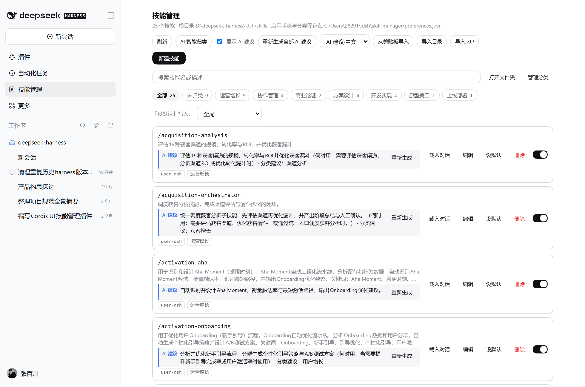
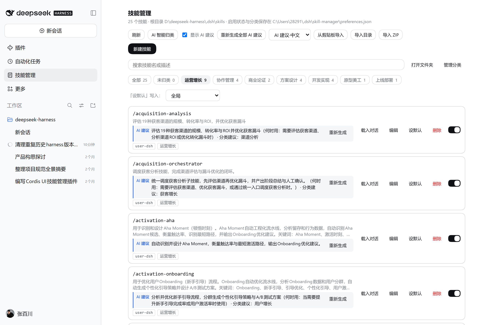

# dsh-skill-manager

Adds a **smart classification + smart usage-suggestion** layer to a [DeepSeek Harness](https://github.com/deepseek-ai/deepseek-harness) skill library: once you have dozens of skills, you can still tell at a glance which one to use.

[English](README.md) | [中文](README.zh.md)

> **v0.3.0** — from "skill file manager" to "skill navigator". Two things changed:
> **① smart classification** (by product/project stage, not by literal words)
> **② smart usage suggestions** (what each skill does and when to use it).

---



Filtered by the 运营增长 stage — the result of smart classification:



## Why this exists

With a handful of skills, `/name` is enough. With twenty or thirty, the problem changes:

- **You don't know what you have** — skills live under project, user and `.agents` roots; which one wins, and which is shadowed by a same-named skill, is invisible.
- **You don't know which one to use** — every `SKILL.md` has rules, but nobody remembers "which one for sprint planning", "which one for API design".
- **Names don't match purposes** — what is the difference between `analysis-funnel` and `analysis-retention`? You have to open and read both.
- **You're afraid to clean up** — switching a skill off means editing or deleting files.

This plugin turns finding, recognising and managing skills into a few rows and switches in a panel.

## The two capabilities unique to this version

### 1. Smart classification: understand the *stage*, not the words

One click on "AI 智能归类" and the model reads each skill's name, description and **body excerpt**, decides where it sits in the delivery flow, and files it into a fixed stage taxonomy:

> 需求分析 · 商业论证 · 方案设计 · 原型美工 · 开发实现 · 测试验收 · 上线部署 · 运营增长 · 成本优化 · 协作管理 · 其他

- The taxonomy is **closed**: the model may only pick from it, so you never get `decision` / `application` style fragments;
- Large libraries are sent in **batches** (12 per call) so a long list cannot make the model return an empty response;
- When the model is unavailable it falls back to a **stage keyword table** (funnel/conversion → 运营增长, token/compression → 成本优化…) — still stages, never plain word clustering;
- Categories you created by hand are never overwritten: generated ones carry an `auto` flag and only those are replaced on a re-run.

### 2. Smart usage suggestions: one generated line per skill

Opening the panel adds, **under the original description**, a line that explains the skill:

```
/analysis-funnel
Evaluates 19 acquisition channels by scale, conversion and ROI…     ← original, never rewritten
AI 建议  Breaks down the channel funnel and locates drop-off points (when: reviewing conversion) · category: 运营增长   [regenerate]
```

- Generated **automatically** for every skill; a global 显示 AI 建议 switch can turn it off;
- Stored in a side file (`$DSH_HOME/skill-manager/suggestions.json`) and **never written into `SKILL.md`**; hashed against file content, so stale suggestions disappear;
- "一键生成 / 重新生成全部 AI 建议" for the whole library, plus per-row regeneration;
- Output language: Chinese or English.

**Both features answer the same question**: with many skills you neither find nor recognise the right one. Classification tells you *which step of the flow* it belongs to; the suggestion tells you *what it does and when to use it*.

## Everything else

| Capability | Detail |
| --- | --- |
| **Enable / disable** | A registry policy override — **source files untouched**, instantly reversible, restored on uninstall. |
| **Default load** | Three scopes merged: **global**, **this project** (matched by project root), **by preset** (e.g. `standard`). |
| **Categories** | Create / rename / delete, optional keywords, many-to-many membership, closable card. |
| **Import** | Clipboard (paste a whole `SKILL.md`), directory (host-native picker), ZIP (unpacked on the host, traversal rejected). |
| **Edit SKILL.md** | Create / edit / delete in the panel; kebab-case validation, never overwrites, preserves unmanaged frontmatter keys. |
| **Shadow reporting** | Flags skills hidden by a higher-ranked root. |
| **First-class sidebar entry** | A `main` panel plus a `sidebar.panellist` row, not buried in Settings. |

## Install

```powershell
dsh plugin --profile desktop add link:D:\path\to\dsh-skill-manager

npm pack
dsh plugin --profile desktop add .\dsh-skill-manager-0.3.0.tgz
```

Restart the DeepSeek Harness app (host plugins load at startup), then refresh; **技能管理** appears in the sidebar.

## Configuration

```yaml
- id: dsh-skill-manager
  name: dsh-skill-manager
  config:
    provider: deepseek-account   # model provider for suggestions / classification
    model: deepseek-flash
    customSkillDirs: ['D:/shared-skills']
    log: false
```

| Field | Default | Meaning |
| --- | --- | --- |
| `provider` / `model` | `deepseek-account` / `deepseek-flash` | Model used for AI suggestions and classification |
| `includeDefaultRoots` | `true` | Scan project and user roots |
| `customSkillDirs` | `[]` | Extra roots at rank 300 |
| `bundledSkillDir` | `$DSH_BUNDLED_SKILL_DIR` | Read-only root at rank 600 |
| `dshHome` / `agentsHome` | `$DSH_HOME` / `$DSH_AGENTS_HOME` | Root resolution base |
| `log` | `true` | Append to `$DSH_HOME/skill-manager/skill-manager.log` |

## How it works

- **Host half** (`lib/`): a rank 0 override provider for enable/disable; `systemPrompt.section` for default loading; endpoints under the official `/api` channel via `connection.fetch.register`; preferences in `$DSH_HOME/skill-manager/preferences.json`, suggestions in `suggestions.json`.
- **Browser half** (`client/src/client/`): registers a `main` panel and a `sidebar.panellist` entry; bundled as a `window.__ModuleLoader__.load({ id, factory })` module that depends on `react` alone.
- **AI**: goes through the host's `ctx.llm`, prompts for JSON only, retries once, then falls back to the stage keyword table.

## Verification

```sh
npm test                  # 29 checks: host / endpoints / bundle / UI rendering
node scripts/verify-v4.mjs http://127.0.0.1:58809   # isolated instance, real model
```

Measured on DSH 0.2.2-rc.1 desktop:

- isolated instance 10/10: suggestions never touch the original file, regeneration works, stage classification comes from the model, all 27 skills assigned;
- UI verified by mounting the real build artifact in jsdom: auto-generation, the global switch writing to preferences, search filtering, scoped default loading;
- after disabling a skill, `/registry` reports `provider: skill-manager` and `modelInvocable: false` — the override really wins in the live registry.

## Known limits

- The "by preset" scope relies on `agentPreset` in session metadata; without it only global and project scopes apply.
- Suggestions are generated one skill at a time: 20+ skills take 1–2 minutes on first open (serial), and the switch turns it off.
- A few edge skills may land in 其他; you can tick the category manually in the edit dialog.
- Only the DSH skill roots that `dsh-skill-filesystem` reads are managed.
- Deletion is permanent (no trash), with confirmation.

## Development

```sh
npm install
npm run build              # esbuild → client/client.js
node test/host.test.mjs
node test/plugin.test.mjs
node test/client.test.mjs
node test/ui.test.mjs
```

## License

MIT.
