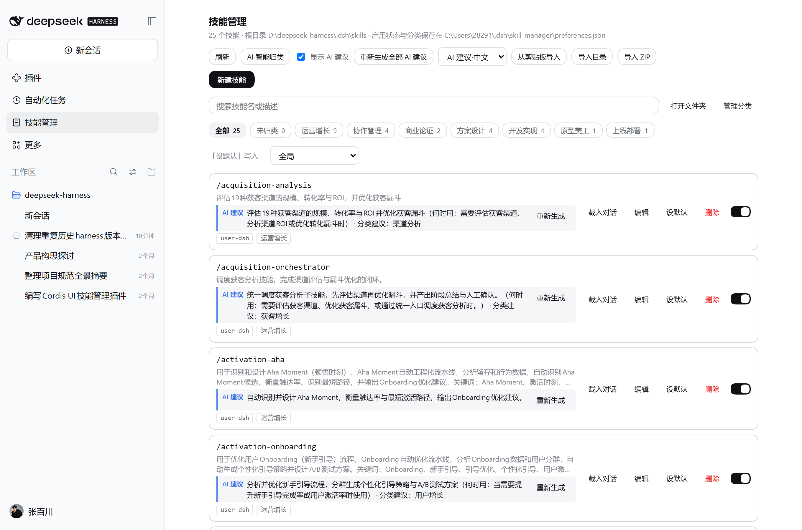
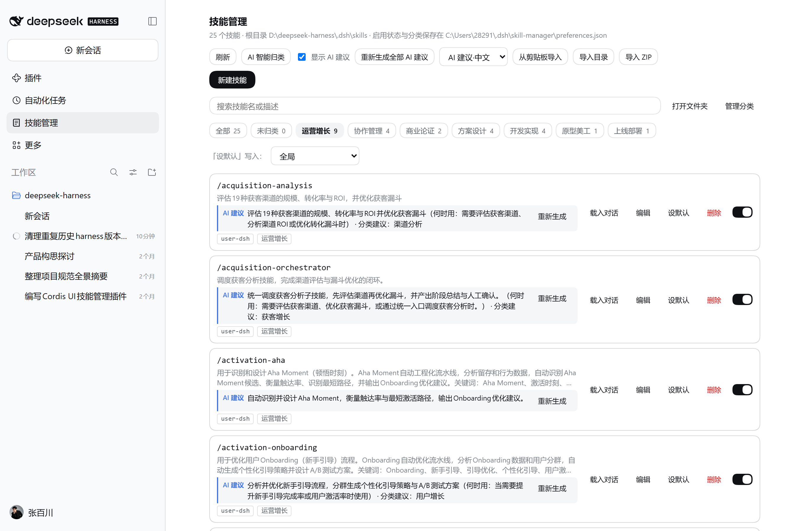

# dsh-skill-manager

给 [DeepSeek Harness](https://github.com/deepseek-ai/deepseek-harness) 的技能库加一层「**智能分类 + 智能使用建议**」：技能再多，也能一眼看出该用哪个。

[English](README.md) | [中文](README.zh.md)

> **v0.3.0** —— 从「技能文件管理器」升级为「技能导航器」。核心变化是两件事：
> **① 智能分类**（按产品/项目阶段归类，不再靠字面词）
> **② 智能使用建议**（自动告诉你每个技能干什么、什么时候用）。

---



按「运营增长」阶段筛选 —— 智能分类的效果：



## 为什么需要它

Skill 少的时候，`/name` 就够了；一旦攒到二三十个，问题会变成另一种：

- **不知道自己有什么** —— 技能散落在项目根、用户根、`.agents` 根里，谁在生效、谁被同名遮蔽，看不出来；
- **不知道该用哪个** —— 每个 `SKILL.md` 都写了规则，但没人记得住「排期该用哪个」「写接口该用哪个」；
- **名字和用途对不上** —— `analysis-funnel` 和 `analysis-retention` 到底差在哪，得点开文件读一遍；
- **不敢清理** —— 关掉一个技能要么改文件、要么删目录，改完还得记得改回来。

这个插件把「找技能、认技能、管技能」变成面板里的几行字和几个开关。

## 这版独有的两个能力

### 1. 智能分类：按「阶段」理解，而不是按字面词

点一次「AI 智能归类」，模型会读每个技能的名称、描述和**正文摘录**，判断它在工作流程的哪个阶段起作用，然后归入固定阶段：

> 需求分析 · 商业论证 · 方案设计 · 原型美工 · 开发实现 · 测试验收 · 上线部署 · 运营增长 · 成本优化 · 协作管理 · 其他

- 阶段名是**写死的清单**，模型只能挑，不能自创 —— 不会出现 `decision`、`application` 这种英文碎片分类；
- 技能多时**分批**送模型（每批 12 个），避免一次塞几十个导致返回空文本；
- 模型不可用时退回**阶段关键词表**兜底（转化/漏斗 → 运营增长，token/压缩 → 成本优化……），结果仍然是阶段，而不是「按相同词聚类」；
- 你手工建的分类不会被覆盖：自动分类带 `auto` 标记，重算时只替换自动的那部分。

### 2. 智能使用建议：自动写一行「这个技能干什么、什么时候用」

打开面板，每个技能会在**原描述下面**自动多出一行 AI 建议：

```
/analysis-funnel
评估19种获客渠道的规模、转化率与ROI…          ← 原描述，永不改写
AI 建议 拆解各渠道的转化漏斗并定位流失节点（何时用：复盘转化率时）· 分类建议：运营增长   [重新生成]
```

- 默认**自动生成**，不需要一个个点；顶部「显示 AI 建议」开关可关掉；
- 建议存在旁路文件 `$DSH_HOME/skill-manager/suggestions.json`，**绝不覆盖 SKILL.md**；带内容哈希，文件改过旧建议自动失效；
- 顶部「一键生成 / 重新生成全部 AI 建议」可批量补齐或全部重算，单行可单独「重新生成」；
- 输出语言可选中文 / English。

**这两个能力解决的是同一个问题**：技能一多，用户既找不到、也认不出该用哪个。分类给的是「它在流程的哪一步」，建议给的是「它到底干什么、何时用」。

## 其余能力

| 能力 | 说明 |
| --- | --- |
| **启用 / 停用** | 注册表策略覆盖实现，**不改源文件**，随时撤销，卸载即恢复。 |
| **默认加载** | 三种作用域合并生效：**全局**、**本项目**（按项目根匹配）、**按预设**（如 `standard`）。 |
| **分类管理** | 新建 / 改名 / 删除分类、配关键词、一个技能可属多类；分类卡片可关闭。 |
| **导入** | 剪贴板（粘贴整段 `SKILL.md`）、目录（宿主原生选择器）、ZIP（浏览器选文件、宿主解压，拒绝越界路径）。 |
| **编辑 SKILL.md** | 面板内新建 / 编辑 / 删除，kebab-case 校验、不覆盖已有技能、保留未托管的 frontmatter 键。 |
| **遮蔽提示** | 同名技能被更高优先级根遮蔽时明确标出。 |
| **侧边栏一级入口** | 不是藏在设置里，而是主面板 + 侧边栏图标。 |

## 安装

```powershell
# 本地开发：链接安装
dsh plugin --profile desktop add link:D:\path\to\dsh-skill-manager

# 或先打包再安装
npm pack
dsh plugin --profile desktop add .\dsh-skill-manager-0.3.0.tgz
```

安装后**重启 DeepSeek Harness 应用**（宿主插件在启动时加载），再刷新页面；侧边栏出现「技能管理」。

## 配置

在 profile 的 `cordis.patch.yml` 里按 id 定向覆盖：

```yaml
- id: dsh-skill-manager
  name: dsh-skill-manager
  config:
    provider: deepseek-account   # AI 建议 / 智能分类用的模型提供方
    model: deepseek-flash        # 具体模型
    customSkillDirs: ['D:/shared-skills']
    log: false
```

| 字段 | 默认 | 含义 |
| --- | --- | --- |
| `provider` / `model` | `deepseek-account` / `deepseek-flash` | AI 建议与分类使用的模型 |
| `includeDefaultRoots` | `true` | 是否扫描项目根与用户根 |
| `customSkillDirs` | `[]` | rank 300 的额外技能根 |
| `bundledSkillDir` | `$DSH_BUNDLED_SKILL_DIR` | rank 600 的内置根（只读） |
| `dshHome` / `agentsHome` | `$DSH_HOME` / `$DSH_AGENTS_HOME` | 根目录解析基准 |
| `log` | `true` | 是否写 `$DSH_HOME/skill-manager/skill-manager.log` |

## 工作原理

- **宿主半边**（`lib/`）：rank 0 覆盖提供方实现启停；`systemPrompt.section` 注入默认加载；`connection.fetch.register` 在官方 `/api` 通道下注册端点；偏好存 `$DSH_HOME/skill-manager/preferences.json`，AI 建议存 `suggestions.json`。
- **浏览器半边**（`client/src/client/`）：注册 `main` 主面板与 `sidebar.panellist` 一级入口，打成 `window.__ModuleLoader__.load({ id, factory })` 模块，只依赖 `react`。
- **AI**：通过宿主的 `ctx.llm` 调模型，提示词要求只输出 JSON；失败重试一次，再失败走阶段关键词兜底。

## 验证

```sh
npm test                  # 29 项：宿主/端点/bundle/界面渲染
node scripts/verify-v4.mjs http://127.0.0.1:58809   # 隔离实例，真实模型
```

在 DSH 0.2.2-rc.1 桌面版上实测：

- 隔离实例 10/10 通过：AI 建议不改原文、可重新生成；阶段分类来自模型，27 个技能全部有归属；
- 界面用 jsdom 挂真实构建产物验证：自动生成建议、全局开关写回偏好、搜索过滤、作用域默认写入；
- 停用某个技能后 `/registry` 里 `provider=skill-manager`、`modelInvocable=false` —— 覆盖提供方在真实注册表里赢得裁决。

## 已知限制

- 「按预设」作用域依赖会话元数据里的 `agentPreset`；没有该字段的部署只落到全局与项目两种作用域。
- AI 建议按技能逐个生成：20+ 个技能首次打开会串行跑 1–2 分钟，可用开关关闭。
- 阶段分类里个别边缘技能（如偏成本优化的工具）可能落到「其他」，可在编辑弹窗里手动勾选分类。
- 只管理与 `dsh-skill-filesystem` 对齐的 DSH 技能根，不聚合 Claude / Cursor / Codex 目录。
- 删除技能是永久的（无回收站），面板有二次确认。

## 开发

```sh
npm install
npm run build              # esbuild → client/client.js
node test/host.test.mjs
node test/plugin.test.mjs
node test/client.test.mjs
node test/ui.test.mjs
```

## 许可证

MIT。
